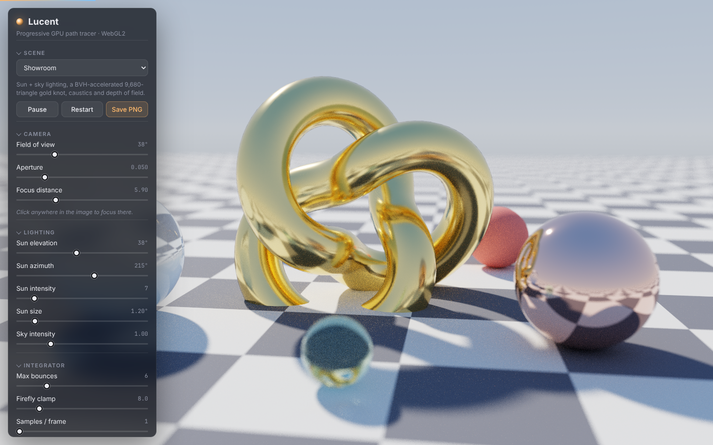
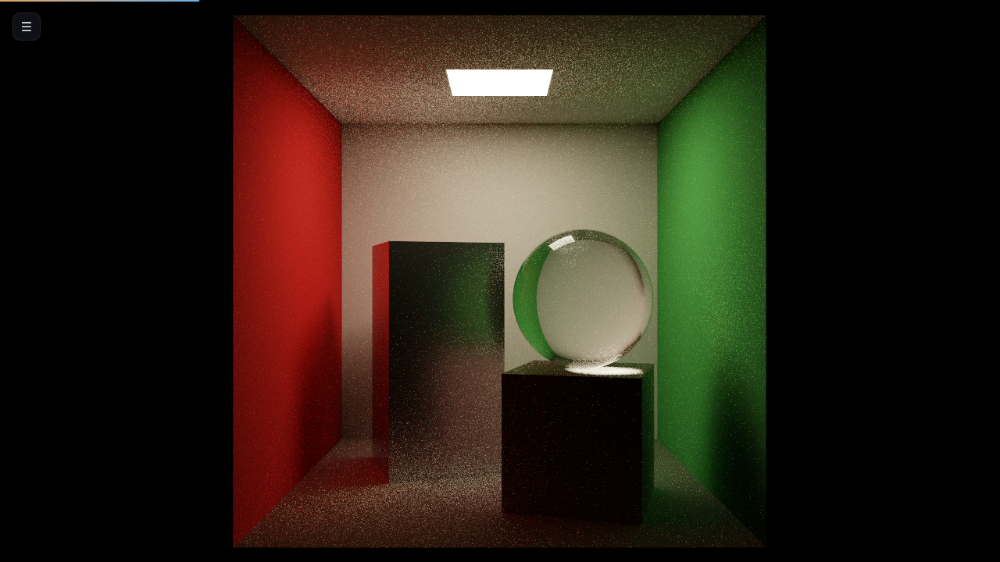
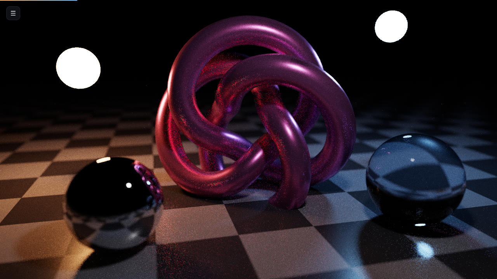
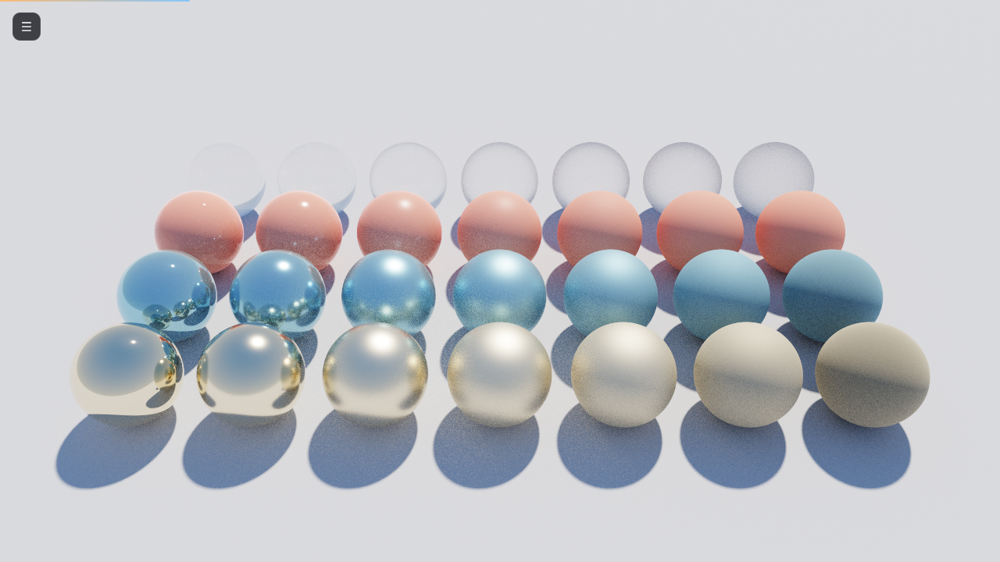
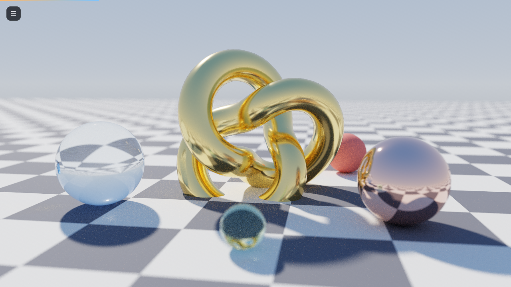

<div align="center">

# Lucent

**A real-time, progressive path tracer that runs entirely on your GPU.**<br>
TypeScript · WebGL2 · GLSL ES 3.0 · zero runtime dependencies · ~24 kB gzipped

[](https://github.com/clark719664/claudes-dream/actions/workflows/ci.yml)
[](https://github.com/clark719664/claudes-dream/actions/workflows/deploy.yml)




*Showroom: a 9,680-triangle gold trefoil, glass, brushed copper and depth of field, lit by a physical sun and sky.*

</div>

---

Lucent is a physically based renderer written from scratch: no three.js, no WebGPU polyfills, no shader libraries. Every photon path is traced in a fragment shader against a bounding-volume hierarchy built in TypeScript, and the result converges on screen as you watch. Drag to orbit, click to refocus, and the image restarts from a clean slate.

It exists to be read as much as to be run. The code is small enough to hold in your head and documented where the ideas are non-obvious.

## Gallery

| | |
|:--:|:--:|
| <br>**Cornell Box** — diffuse interreflection and colour bleeding from one area light, sampled explicitly | <br>**Nocturne** — no sky; three emitters light a chrome sphere, glass and a (3,4) torus knot |
| <br>**Material Study** — roughness sweeps left to right across rough glass, dielectric, dielectric→metal and gold | <br>**Showroom** — sun + sky, caustics through glass, thin-lens bokeh |

## What's inside

**Rendering**

- **Unidirectional path tracing** with Russian roulette, progressive accumulation into ping-ponged `RGBA32F` targets, and a separate tone-mapping pass (ACES filmic, Reinhard or clip) with dithering.
- **Next-event estimation with multiple importance sampling** (power heuristic) against sphere lights, quad lights and a sun of finite angular size. Emitter hits via BSDF sampling are weighted by the matching solid-angle pdf, so there is no double counting and no dependence on luck for small lights.
- **Microfacet BSDF**: Lambert + GGX with Smith masking, Schlick Fresnel, and [visible-normal sampling](https://jcgt.org/published/0007/04/01/) (Heitz 2018). Metallic, roughness, transmission and IOR are the knobs; glass is a stochastic dielectric with a roughened normal.
- **Thin-lens camera** with concentric-disk bokeh and a planar focal plane. Click any point to focus there: the pick ray is intersected on the CPU with the same BVH the GPU uses.
- **Procedural sky** with a horizon gradient and sun glow; the sun disc itself is only ever added with an MIS weight.
- **Firefly suppression** via a luminance clamp on indirect contributions, user-adjustable because it trades bias for variance.

**Acceleration**

- **Binned SAH BVH** built in TypeScript (12 bins, leaf cost vs. split cost, median fallback for degenerate centroids) and flattened to an 8-float node layout where sibling nodes are adjacent, so an interior node stores one child index.
- **Texture-backed geometry**: triangles, nodes and materials are uploaded as 2048-wide `RGBA32F` textures and addressed with `texelFetch` as flat arrays. Triangles are written in leaf order so leaves index the triangle texture directly, with no indirection table.
- **Stack-based traversal** on the GPU with near-child-first ordering and a separate any-hit variant for shadow rays.

**Engineering**

- Strict TypeScript (`noUncheckedIndexedAccess`, `exactOptionalPropertyTypes`), ESLint, Vitest.
- A `#include` preprocessor for GLSL that rewrites driver error messages back to chunk names and line numbers.
- 36 unit tests covering the math library, BVH construction invariants, BVH-vs-brute-force agreement on random soups and real meshes, mesh generators (closed-surface checks), material packing round-trips and scene packing.
- GitHub Actions for lint → typecheck → test → build, and a Pages deployment.

## Run it

```bash
npm install
npm run dev        # http://localhost:5173
```

```bash
npm test           # unit tests
npm run lint
npm run typecheck
npm run build      # production bundle in dist/
```

Requires a browser with WebGL2 and `EXT_color_buffer_float` (every current desktop browser). A discrete GPU gives tens of samples per pixel per second at 1080p; integrated graphics still converge in seconds.

### Controls

| Input | Action |
|---|---|
| Drag | Orbit |
| Shift-drag / right-drag | Pan |
| Wheel | Dolly |
| Click | Set focus distance |
| `Space` | Pause / resume |
| `R` | Restart accumulation |
| `S` | Save PNG |
| `H` | Hide / show panel |

URL parameters: `?scene=2` selects a preset, `&ui=0` hides the panel.

## How it works

```
                 TypeScript (once per scene)                      GPU (every frame)
 ┌──────────────────────────────────────────────┐   ┌──────────────────────────────────────┐
 │  presets.ts ──► Scene { spheres, meshes,     │   │  trace.frag                          │
 │                         camera, sun, sky }   │   │   ├─ cameraRay()  thin lens + jitter │
 │        │                                     │   │   ├─ traceScene() BVH + spheres      │
 │        ▼                                     │   │   ├─ NEE: sun + one emitter (MIS)    │
 │  packScene() ─┬─ buildBVH()  SAH, flattened  │   │   ├─ sampleOpaque() / sampleDielectric│
 │               ├─ triangles  (leaf order)     │──►│   └─ running average ──► RGBA32F     │
 │               ├─ materials  (4 texels each)  │   │                     ▲      │  ping   │
 │               └─ lights     (sphere | quad)  │   │                     └──────┘  pong   │
 │        │                                     │   │  display.frag                        │
 │        ▼                                     │   │   └─ exposure → ACES → sRGB → dither │
 │  createDataTexture() ×3  (2048-wide RGBA32F) │   └──────────────────────────────────────┘
 └──────────────────────────────────────────────┘
```

**One sample, one pixel.** Each frame the trace shader generates a jittered camera ray, follows it for up to *N* bounces, and blends the returned radiance into the running average `(prev · n + L) / (n + 1)`. Any change to the camera, lights or integrator settings resets `n` to zero.

**At every opaque vertex** the integrator does three things: samples a direction towards the sun, samples a point on one randomly chosen emitter, and samples the BSDF to continue the path. The first two are shadow-tested with the any-hit traversal and weighted with the power heuristic against the BSDF pdf; when the continued path later hits an emitter, the emitter's own solid-angle pdf is recomputed from the previous vertex so the two estimators combine without bias.

**Glass is a delta lobe.** Dielectrics pick reflection or refraction by Fresnel, flag the bounce as specular, and skip light sampling; whatever they hit next is counted in full. Roughness perturbs the microfacet normal before the Fresnel decision, which is a cheap approximation to rough transmission that looks right.

**The BVH layout** is the detail that makes the shader simple. A node is two texels: `(min.xyz, leftFirst)` and `(max.xyz, count)`. `count > 0` means a leaf whose triangles start at `leftFirst`; otherwise the children are `leftFirst` and `leftFirst + 1`. Because triangles are reordered into leaf order at pack time, the GPU never touches an index buffer.

## Project layout

```
src/
├── main.ts              app wiring, keyboard shortcuts, render loop
├── renderer.ts          Renderer: targets, uniforms, accumulate/present, picking
├── gl/
│   ├── context.ts       context creation, Program, RenderTarget, data textures
│   └── preprocess.ts    #include resolver with #line remapping
├── math/
│   ├── vec3.ts          immutable tuple vectors
│   ├── aabb.ts          bounds, SAH surface area, slab test
│   ├── ray.ts           Möller–Trumbore and sphere intersection
│   └── bvh.ts           binned SAH build, flattened layout, CPU traversal
├── scene/
│   ├── material.ts      principled-lite material + texel packing
│   ├── mesh.ts          quad, box, floor, torus knot, transforms
│   ├── scene.ts         Scene types, packScene(), light extraction, picking
│   └── presets.ts       the four demo scenes
├── shaders/
│   ├── common.glsl      PCG RNG, bases, sampling, MIS
│   ├── scene.glsl       texture fetches, BVH traversal, any-hit
│   ├── lights.glsl      sky, sun, sphere/quad light sampling & pdfs
│   ├── bsdf.glsl        GGX/VNDF, Fresnel, opaque & dielectric sampling
│   ├── trace.frag       the integrator
│   └── display.frag     tone mapping
└── ui/                  orbit controls, panel, DOM helper, styles
test/                    Vitest suites (math, BVH, meshes, scene packing, preprocessor)
```

## Design notes

- **Why uniform arrays for spheres but textures for triangles?** Spheres are few and analytic; a uniform array is the fastest path and keeps them out of the BVH. Triangles can number in the hundreds of thousands, which only fits in textures.
- **Why not WebGPU?** Compute shaders would allow wavefront path tracing and a cleaner traversal, but WebGL2 runs everywhere today including iOS, and a fragment-shader megakernel is a better teaching artefact: the entire integrator is one readable file.
- **Why clamp fireflies at all?** Caustic paths (diffuse → glass → light) have unbounded variance in a unidirectional tracer. The clamp only affects indirect bounces and is exposed in the UI, so you can see exactly what it costs.
- **Shading normals** on the knot are guarded against facing away from the geometric normal, which otherwise produces black silhouettes on smooth meshes.

## Roadmap

- Triangle-mesh loading (glTF) and textured materials
- Environment maps with importance sampling
- Spectral dispersion for dielectrics
- A temporal denoiser for the first few samples

## License

MIT
