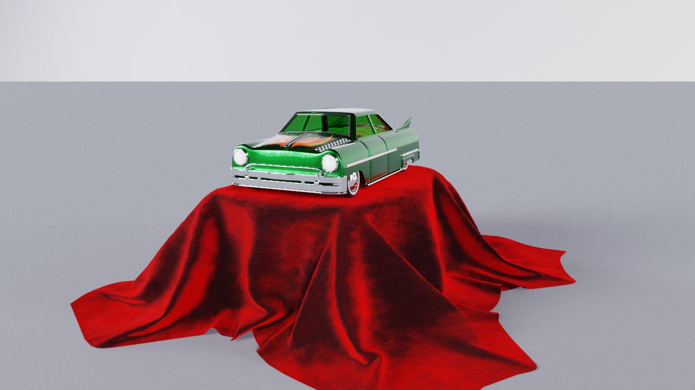
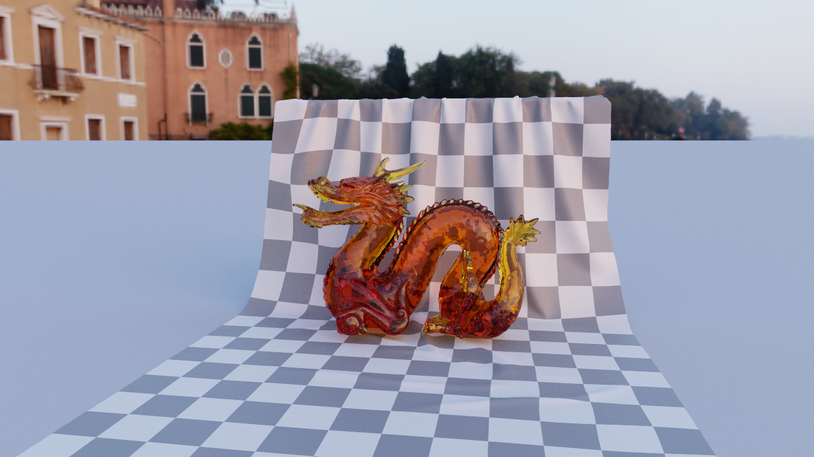
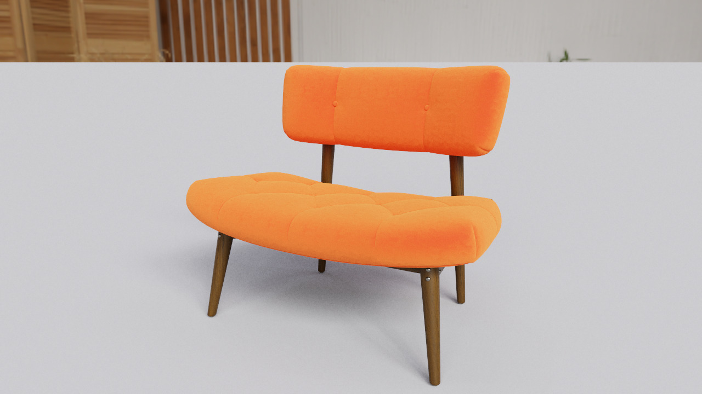
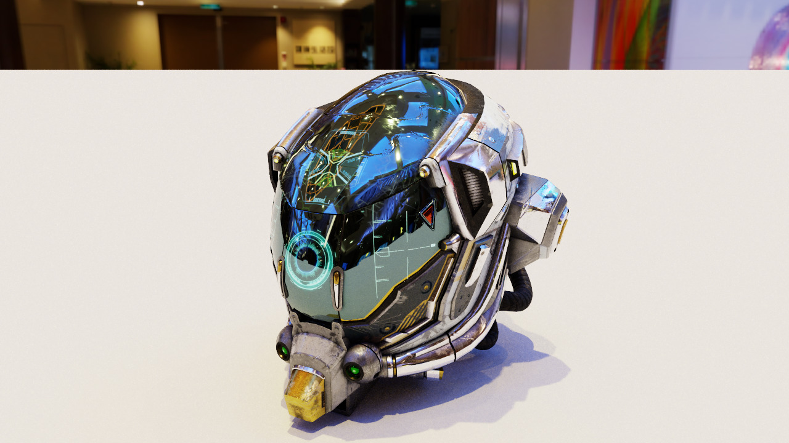
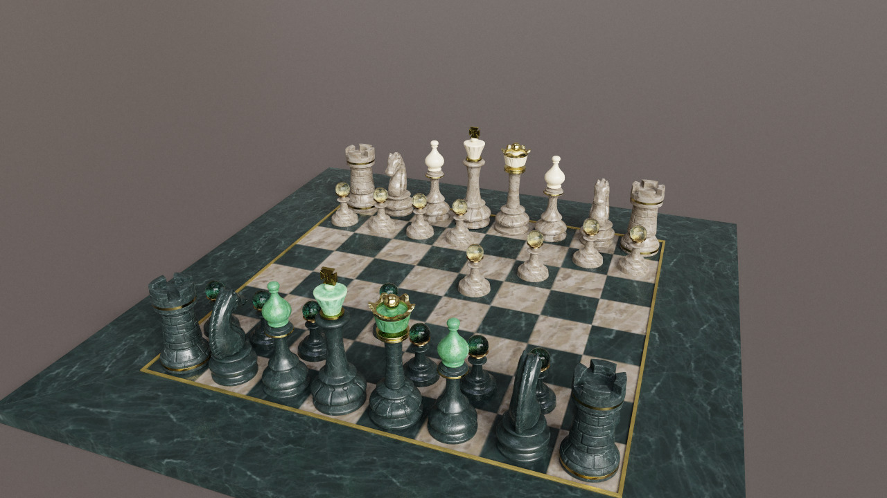
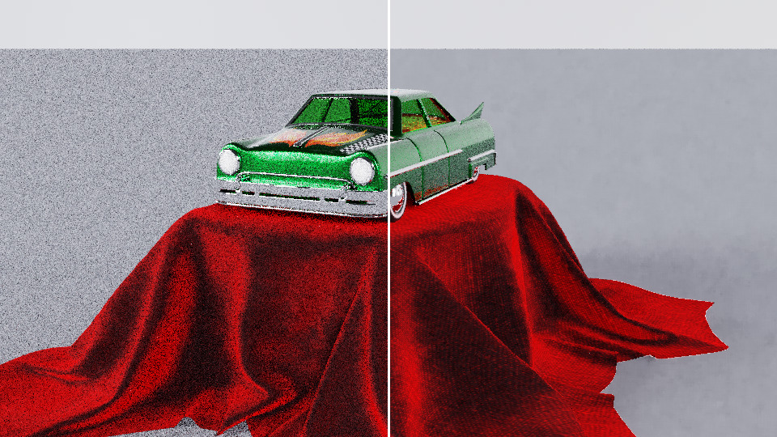

<div align="center">

# Lucent

**A real-time, progressive path tracer that runs entirely on your GPU.**<br>
TypeScript · WebGL2 · GLSL ES 3.0 · zero runtime dependencies · ~49 kB gzipped

**[Open the live demo →](https://clark719664.github.io/lucent/)**

[](https://github.com/clark719664/lucent/actions/workflows/ci.yml)
[](https://github.com/clark719664/lucent/actions/workflows/deploy.yml)


*Car Concept (glTF, 213,347 triangles) under a Poly Haven dawn HDRI: clearcoat paint, glass and a glossy ground. 1024 samples per pixel at 1440 × 900 in 26 s on a Radeon RX 7600.*

</div>

---

Lucent is a physically based renderer written from scratch: no three.js, no WebGPU polyfills, no shader libraries. Drop a glTF model onto the page and it is traced in a fragment shader against a bounding-volume hierarchy built in TypeScript, lit by an importance-sampled HDRI, denoised while it converges and reprojected while you orbit.

It exists to be read as much as to be run. The code is small enough to hold in your head and documented where the ideas are non-obvious.

## Gallery

| | |
|:--:|:--:|
| <br>**Toy Car**: clearcoat paint, sheen fabric, glass | <br>**Dragon**: refraction with Beer–Lambert absorption |
| <br>**Sheen Chair**: Charlie sheen velvet, texture transforms | <br>**Damaged Helmet**: metal-rough, normal and emissive maps |
| <br>**A Beautiful Game**: 1,499,072 triangles, 33 textures | <br>**Denoiser**: the same 8 samples per pixel, raw (left) and filtered (right) |

The glTF models above are in the in-app gallery and stream from the [Khronos glTF sample assets](https://github.com/KhronosGroup/glTF-Sample-Assets); the four built-in scenes need no network at all:

| | |
|:--:|:--:|
| <br>**Showroom**: sun + sky, caustics through glass, thin-lens bokeh | <br>**Cornell Box**: diffuse interreflection from one area light |
| <br>**Material Study**: roughness sweeps across glass, dielectric and metal | <br>**Nocturne**: no sky; three emitters, chrome, glass and a torus knot |

## What's inside

**Scenes**

- **glTF 2.0 and GLB loading**, written from scratch and tested under Node: node hierarchies, indexed, strip and fan primitives, interleaved, normalized and sparse accessors, mirrored transforms. Drop a `.glb`, a `.gltf` with its `.bin` and images, or the folder holding them, or use *Open file…*.
- **PBR materials**: base colour with alpha mask and blend, metal-rough, normal and emissive maps, `KHR_texture_transform`, and the `transmission`, `ior`, `volume`, `clearcoat`, `sheen`, `emissive_strength` and `unlit` material extensions. Extensions it does not model are listed in a toast rather than silently dropped; files that require Draco, meshopt or KTX2 are refused with a clear message.
- **Textures** are resampled on the GPU (mipmapped, filtered in linear space) into one sRGB and one linear 2D texture array, sized to a 256 MB budget.
- **Gallery** of Khronos sample models, each paired with a CC0 HDRI from Poly Haven, plus the four built-in scenes.

**Rendering**

- **Unidirectional path tracing** with Russian roulette, per-pixel running averages in ping-ponged multiple render targets, and a separate tone-mapping pass (ACES filmic, Reinhard or clip) with dithering.
- **HDRI environments with importance sampling.** Radiance `.hdr` files are decoded in TypeScript; the map is split into up to 1024 × 512 cells weighted by luminance × sin θ and turned into a [Walker alias table](https://en.wikipedia.org/wiki/Alias_method), so drawing a light sample costs one texel fetch, and the exact piecewise-constant pdf is available for MIS. The procedural sky is baked into the same path, so even the built-in scenes sample their sky explicitly now.
- **Next-event estimation with multiple importance sampling** (power heuristic) against the environment map, sphere lights, quad lights and a sun of finite angular size.
- **Layered BSDF**: a GGX clearcoat (with its own, un-normal-mapped normal) over Charlie sheen over a Lambert + GGX base with [visible-normal sampling](https://jcgt.org/published/0007/04/01/). Every lobe takes part in one mixture pdf, so MIS sees the whole material. F0 follows the IOR; sheen is energy-compensated with an albedo table integrated at start-up.
- **Glass**: a stochastic dielectric with a roughened normal, thin-walled sheets that transmit without bending, and Beer–Lambert absorption inside volumes.
- **Alpha cut-outs in the traversal**: alpha-tested triangles are evaluated as an any-hit test in both closest-hit and shadow rays, so leaves cast leaf-shaped shadows.
- **Thin-lens camera** with click-to-focus (the pick ray is intersected on the CPU with the same BVH the GPU uses), and scale-independent ray offsets ([Wächter & Binder 2019](https://link.springer.com/chapter/10.1007/978-1-4842-4427-2_6)) so a 5 cm model and a 50 m floor need no tuned epsilon.

**Interaction**

- **Denoiser**: an SVGF-style edge-avoiding à-trous filter ([Dammertz 2010](https://jo.dreggn.org/home/2010_atrous.pdf), [Schied 2017](https://research.nvidia.com/publication/2017-07_spatiotemporal-variance-guided-filtering-real-time-reconstruction-path-traced)). The trace pass writes albedo, normal and depth guides at the first non-mirror vertex, so reflections and refractions keep their detail. Lighting is demodulated by albedo, filtered with a variance-guided luminance edge-stop, then multiplied back; the filter's reach shrinks as samples accumulate and it fades out by 1024 spp.
- **Temporal reprojection**: when the camera moves, every sample projects its primary hit into the previous view and reuses that pixel's history if depth and normal agree. How much history a pixel may keep depends on how glossy it is, so mirrors and glass never smear.
- **GPU budget**: work is scheduled against a share of wall-clock time instead of "as fast as possible". A token bucket earns GPU time as the clock runs and each frame only starts the samples it can afford, so a 25% budget means about 25% even when one sample costs more than a frame. The cost of a sample comes from GPU timer queries where the browser has them, and from a synchronous re-measure every 2 s where it does not.
- **Presets and a system scan**: Eco, Balanced, High and Max bundle the budget with frame-rate cap, resolution, bounces and a stop-at sample count. *Scan system* times a few samples of the current scene, scales the cost to the full canvas and picks the preset; it runs once on a first visit and the result is kept in local storage. Once the stop count is reached the page stops drawing entirely, and it can pause whenever the window loses focus.
- **Adaptive preview**: resolution drops (never below half, upsampled with Catmull-Rom) only when frames take longer than 40 ms.
- **HUD** with samples per pixel, samples per second and camera paths per second, all measured.

**Acceleration**

- **Binned SAH BVH** built in TypeScript on flat typed arrays with an explicit stack (12 bins; large nodes bin all three axes), on a Web Worker for big models so the page keeps rendering. Nodes flatten to an 8-float layout where siblings are adjacent.
- **Texture-backed geometry**: triangle positions (3 texels) and shading attributes (4 texels) live in separate 2048-wide `RGBA32F` textures, so traversal touches only what intersection needs. Triangles are written in leaf order; there is no index buffer.

**Engineering**

- Strict TypeScript (`noUncheckedIndexedAccess`, `exactOptionalPropertyTypes`), ESLint, Vitest.
- 79 unit tests: the GPU-budget scheduler (held to its budget in simulation for per-sample costs from 0.5 to 120 ms), preset recommendation, the glTF parser (GLB containers, hierarchies, strips, interleaved and sparse data, extensions), the RGBE decoder, alias tables, the environment pdf integrating to one, the sheen table against Monte Carlo, BVH invariants and BVH-vs-brute-force agreement, mesh generators, material and scene packing.
- A `#include` preprocessor for GLSL that rewrites driver error messages back to chunk names and line numbers.
- GitHub Actions for lint → typecheck → test → build, and a Pages deployment.

## Performance

Measured with `Renderer.benchmark()`, which waits for the GPU with a 1-pixel readback, at 1280 × 720 on an AMD Radeon RX 7600 (Chrome, ANGLE/D3D11), 6 bounces:

| Scene | Triangles | Camera paths / s | ms per sample |
|---|---:|---:|---:|
| Cornell Box | 36 | 106 M | 8.7 |
| Car Concept | 213,347 | 62 M | 14.8 |
| Toy Car | 108,936 | 54 M | 17.2 |
| A Beautiful Game | 1,499,072 | 49 M | 19.0 |
| Showroom | 9,682 | 47 M | 19.6 |

Those figures are raw speed (the benchmark ignores the budget). With the budget in force, Windows' per-process GPU counters on the same machine read 44% for Balanced (50% budget), 26% for Eco (25%), and 0.3% once the stop count is reached, while the page keeps running.

Showroom is slower than models with twenty times its triangles because sunlit glass and a mirror-finish gold knot keep paths alive for every bounce. One denoiser run costs 2–10 ms at this size. The 1.5 M-triangle chess set builds its BVH in about 3 s on the worker, then packs and uploads in under a second.

## Run it

```bash
npm install
npm run dev        # http://localhost:5173
```

```bash
npm test           # unit tests
npm run lint
npm run typecheck
npm run build      # production bundle in dist/
```

Requires a browser with WebGL2 and `EXT_color_buffer_float` (every current desktop browser).

### Controls

| Input | Action |
|---|---|
| Drag | Orbit |
| Shift-drag / right-drag | Pan |
| Wheel | Dolly |
| Click | Set focus distance |
| Drop files | Load a `.glb`, a `.gltf` with its files or folder, or an `.hdr` |
| `G` | Gallery |
| `D` | Denoiser on / off |
| `Space` | Pause / resume |
| `R` | Restart accumulation |
| `S` | Save PNG (as displayed, denoised and tone-mapped) |
| `H` | Hide / show panel |

URL parameters: `?scene=2` selects a built-in scene, `?model=ToyCar` a gallery model, `&ui=0` hides all chrome.

## How it works

```
 TypeScript (once per scene)                        GPU (every frame)
 ┌──────────────────────────────────────────┐   ┌────────────────────────────────────────────┐
 │ loaders/gltf.ts ─► meshes, materials,    │   │ trace.frag  (MRT, per pixel)               │
 │ loaders/hdr.ts     images, HDR map       │   │  ├─ cameraRay()   thin lens + jitter       │
 │        │                                 │   │  ├─ traceScene()  BVH, alpha any-hit       │
 │        ▼                                 │   │  ├─ NEE: env (alias) + sun + emitter, MIS  │
 │ bvh.worker.ts ─ binned SAH, flattened    │──►│  ├─ layered BSDF / dielectric              │
 │ packScene()   ─ geometry, attributes,    │   │  └─ reproject or accumulate ─► 4 targets   │
 │                 materials, texture layers│   │ variance.frag + atrous.frag ×1–5  denoise  │
 │ buildEnvSampler() ─ alias table          │   │ display.frag  remodulate, upsample, tone   │
 └──────────────────────────────────────────┘   └────────────────────────────────────────────┘
```

**One sample, one pixel.** Each frame the trace shader generates a jittered camera ray, follows it for up to *N* bounces and blends the result into the pixel's running average `(prev · n + L) / (n + 1)`, where *n* is stored per pixel. Lighting or scene changes reset *n*; camera changes reproject it.

**At every opaque vertex** the integrator samples the environment map, the sun and one randomly chosen emitter, shadow-tests each with the any-hit traversal and weights it with the power heuristic against the BSDF pdf; then it samples the BSDF to continue. When the continued path later escapes or hits an emitter, the matching light pdf is recomputed so the estimators combine without bias.

**The environment sampler** picks a cell uniformly, keeps it with the alias table's probability or jumps to its alias, then picks a uniform point inside it. The cell's probability divided by the equirect Jacobian `2π² sin θ` is the exact solid-angle pdf, which `envPdf()` recomputes for any direction a BSDF sample escapes along.

**The denoiser never sees textures.** Radiance is divided by the guide albedo before filtering and multiplied back after, so blurring the illumination cannot blur a decal. Guides are taken at the first non-mirror vertex, so a car's windscreen is denoised with the albedo of the seats behind it.

**The BVH layout** keeps the shader simple. A node is two texels: `(min.xyz, leftFirst)` and `(max.xyz, count)`. `count > 0` means a leaf whose triangles start at `leftFirst`; otherwise the children are `leftFirst` and `leftFirst + 1`.

## Project layout

```
src/
├── main.ts              app wiring: gallery, drag-and-drop, keyboard, render loop
├── renderer.ts          Renderer: targets, uniforms, accumulation, reprojection, denoiser, picking
├── gallery.ts           remote models and HDRIs
├── gl/
│   ├── context.ts       context, Program, MRT targets, data textures, texture arrays
│   └── preprocess.ts    #include resolver with #line remapping
├── loaders/
│   ├── gltf.ts          glTF 2.0 / GLB parser (DOM-free)
│   ├── hdr.ts           Radiance RGBE decoder
│   └── model.ts         files and URLs → decoded images → framed Scene
├── math/
│   ├── vec3.ts, aabb.ts, ray.ts
│   ├── bvh.ts           binned SAH build, flattened layout, CPU traversal
│   ├── bvh.worker.ts    off-thread builds; bvh-async.ts picks the thread
│   └── alias.ts         Walker/Vose alias tables
├── scene/
│   ├── material.ts      principled material + texel packing
│   ├── environment.ts   HDR images, importance sampler, sky baking
│   ├── sheen.ts         sheen albedo table
│   ├── mesh.ts          quad, box, floor, torus knot, transforms
│   ├── scene.ts         Scene types, packScene(), light extraction, picking
│   └── presets.ts       the built-in scenes
├── shaders/
│   ├── common.glsl      PCG RNG, bases, sampling, MIS, ray offsets
│   ├── scene.glsl       geometry and material fetches, BVH traversal, alpha any-hit
│   ├── lights.glsl      environment, sun, sphere/quad lights and their pdfs
│   ├── bsdf.glsl        clearcoat, sheen, GGX/VNDF, dielectrics
│   ├── trace.frag       the integrator and temporal reprojection
│   ├── variance.frag, atrous.frag, denoise.glsl   the denoiser
│   ├── display.frag     remodulation, upsampling, tone mapping
│   └── resample.frag    texture-array layer resampling
└── ui/                  panel, HUD, gallery, drag-and-drop, orbit controls, DOM helper, styles
test/                    Vitest suites
```

## Design notes

- **Why an alias table rather than a CDF?** A two-level CDF needs a binary search per light sample, about 20 dependent texture fetches on a 1024 × 512 grid; the alias table needs one. Both give the same exact pdf.
- **Why are mirrors excluded from reprojection?** A reflection does not move with the surface that shows it, so reprojected mirror radiance smears. Pixels keep history in proportion to how rough and how non-metallic their surface is; glass and polished metal start from fresh samples each frame and lean on the denoiser instead.
- **Why texture arrays?** WebGL2 has no bindless textures. Two arrays (sRGB and linear) at one shared size keep the sampler count fixed whatever the model; resampling happens once on the GPU.
- **Why not WebGPU?** Compute shaders would allow wavefront path tracing, but WebGL2 runs everywhere today, and a fragment-shader megakernel keeps the whole integrator in one readable file.
- **Why clamp fireflies at all?** Caustic paths (diffuse → glass → light) have unbounded variance in a unidirectional tracer. The clamp only affects indirect bounces and is exposed in the UI.

## Roadmap

- Next-event estimation for emissive triangles (glTF emitters are found by BSDF sampling only)
- `KHR_lights_punctual`, Draco / meshopt geometry and KTX2 textures
- Spectral dispersion for dielectrics
- OpenEXR environments

## Credits

Gallery models: [Khronos glTF sample assets](https://github.com/KhronosGroup/glTF-Sample-Assets); Toy Car (Guido Odendahl, Eric Chadwick, CC0), Dragon (Stanford CG Lab and Morgan McGuire; glTF CC0), Sheen Chair and Velvet Sofa (Wayfair; CC0 and CC BY), Damaged Helmet (theblueturtle_, CC BY-NC; ctxwing, CC BY), Car Concept and Chronograph Watch (Darmstadt Graphics Group, CC BY), Antique Camera (UX3D, CC0), A Beautiful Game (ASWF, Ed Mackey, CC BY). HDRIs: [Poly Haven](https://polyhaven.com/hdris), CC0.

## License

MIT
